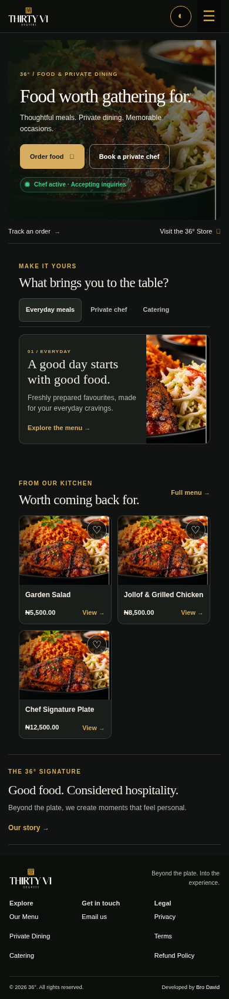
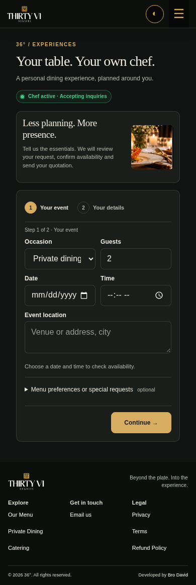
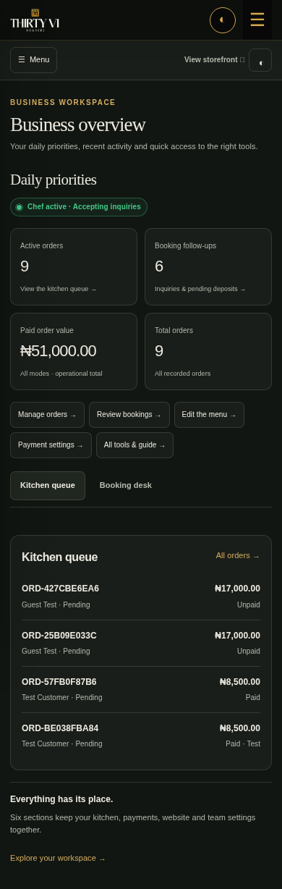
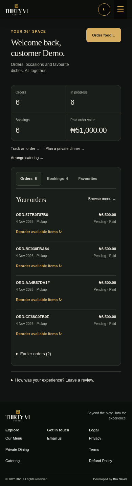
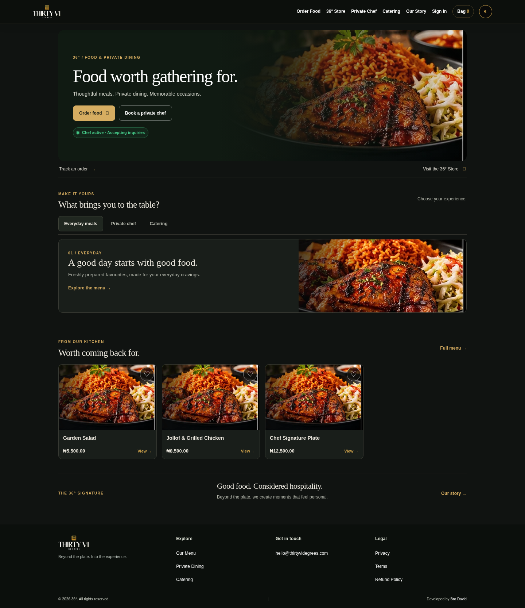
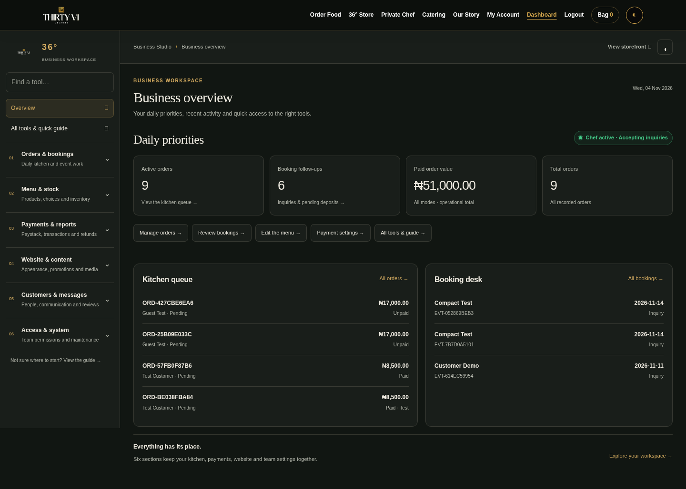
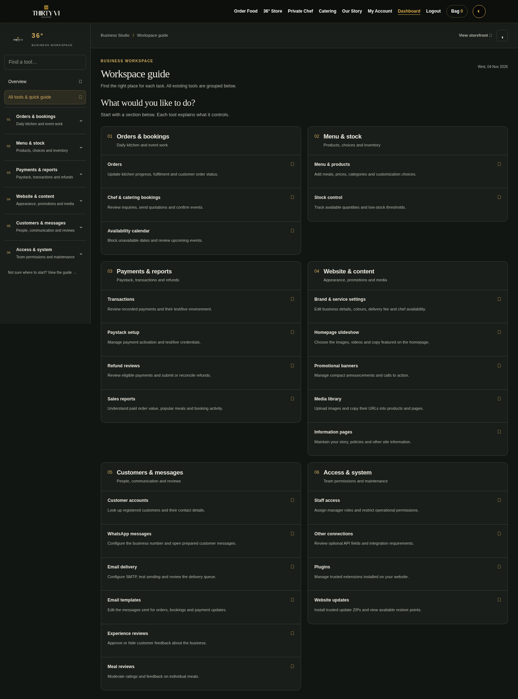

# 36° Compact Experience — 6.1.0

A calmer, more compact restaurant and booking experience for the installed **6.0.0** platform.

**[Download the update ZIP](thirtyvi-degrees-update-6.1.0.zip)** — open the file, then click GitHub's **Download raw file** arrow. Upload that ZIP through your website's existing **Site Updates** page. Your Paystack credentials are retained; no database migration is included.

Read [installation and menu guide](INSTALL.md) and [validation/limitations](VALIDATION.md). The checksum is in [SHA256SUMS.txt](SHA256SUMS.txt).

## Mobile previews

| Homepage | Two-step chef inquiry |
|---|---|
|  |  |

| Admin overview | Customer account |
|---|---|
|  |  |

## Desktop previews

Preview records are synthetic test data. Existing brand media is reused; real product images and saved homepage slides on your installation remain your own content.
